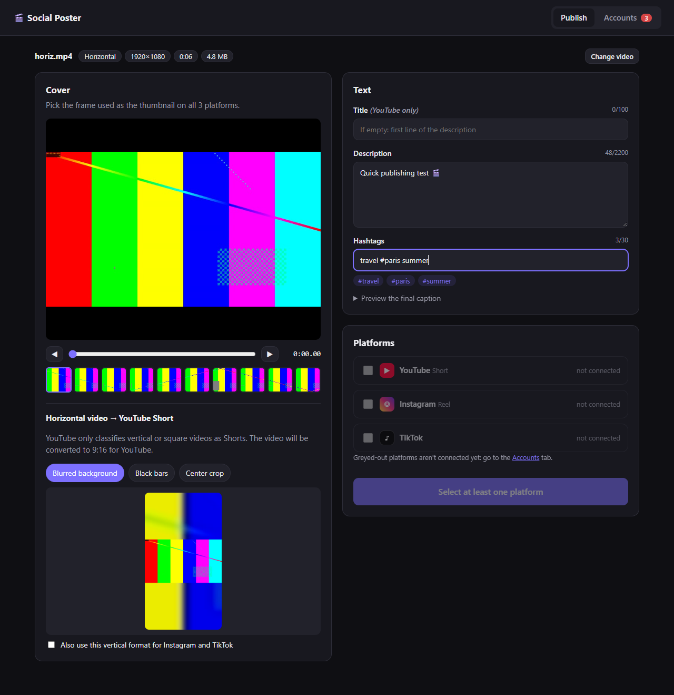

# 🎬 Social Poster

Publish **one video** to **YouTube (Shorts)**, **Instagram (Reels)** and **TikTok** in one go, with **the same description, hashtags and cover**.



- 📥 Drag and drop a **vertical or horizontal** video (MP4, MOV, WEBM, MKV…).
- 🖼️ Pick the **cover from the video's own frames** (slider, frame by frame, or thumbnail strip).
- 📱 **Horizontal videos are converted to 9:16** so they are published as **YouTube Shorts** (blurred background, black bars or center crop). You can also apply that format to Instagram and TikTok.
- ✅ **Tick or untick** platforms: post to one, two or all three. Platforms you haven't set up are simply greyed out.
- 🔒 Everything runs **on your computer**. Your login tokens stay in the `data/` folder, which is never pushed to GitHub.

Project website (privacy policy & terms): <https://timcat62.github.io/tiktok-instagram-youtube-poster/>

---

## Table of contents

1. [Read this first: platform limits](#read-this-first-platform-limits)
2. [Installation](#installation)
3. [Account setup](#account-setup)
   - [Step 0: your project website (privacy policy & terms)](#step-0-your-project-website-privacy-policy--terms)
   - [YouTube](#youtube)
   - [Instagram](#instagram)
   - [TikTok](#tiktok)
4. [Usage](#usage)
5. [How it works](#how-it-works)
6. [Troubleshooting](#troubleshooting)
7. [Customizing the project](#customizing-the-project)

---

## Read this first: platform limits

Each platform requires you to create a free **"developer app"** under your name. The platforms impose a few limits; the tool can't work around them:

| Platform | What works right away | What needs an approval |
|---|---|---|
| **YouTube** | Uploads work, but videos are **locked to private**. | Publishing **public** videos requires passing the free **YouTube API audit** ([form](https://support.google.com/youtube/contact/yt_api_form), step-by-step guide below). Expect a few days to several weeks. |
| **Instagram** | **Everything**, as long as your Meta app stays in Development mode and you post to your own account. | Nothing for personal use. The login lasts **60 days**, then click "Reconnect". |
| **TikTok** | **Draft mode** (the video lands in your TikTok inbox and you post it from the app). **Direct posting** works only with a **private** TikTok account, posted as "Only me". | Public direct posting requires the **TikTok app review + Content Posting API audit**. TikTok often rejects apps that look like personal tools, so draft mode is the realistic option for individuals. |

Other rules:
- **YouTube Shorts**: 3 minutes max. Longer videos are published as regular videos.
- **Instagram Reels**: 3 seconds to 15 minutes, captions up to 2,200 characters and 30 hashtags, 100 API posts per 24 h.
- **TikTok**: max duration depends on your account (shown in the app).

---

## Installation

1. Install **Python 3.10 or newer** from <https://www.python.org/downloads/>. On Windows, tick **"Add python.exe to PATH"** on the first installer screen.
2. Download this project: green **Code → Download ZIP** button, then unzip it. Or run `git clone https://github.com/Timcat62/tiktok-instagram-youtube-poster.git`.
3. Start the app:
   - **Windows**: double-click `run.bat`
   - **macOS / Linux**: run `./run.sh` in a terminal

The first time, dependencies install automatically. ffmpeg is included, so there's nothing else to install. The interface then opens in your browser at <http://localhost:8765>.

> Keep the terminal window open while you use the app.

---

## Account setup

You **only need to set up the platforms you use**. Each one takes 15 to 30 minutes, once.

Values you will need below (keep this list handy):

| What | Value |
|---|---|
| App name | `Social Poster` (any name **without** "YouTube", "Instagram", "Facebook" or "TikTok") |
| Website | `https://timcat62.github.io/tiktok-instagram-youtube-poster/` |
| Privacy policy | `https://timcat62.github.io/tiktok-instagram-youtube-poster/privacy.html` |
| Terms of service | `https://timcat62.github.io/tiktok-instagram-youtube-poster/terms.html` |
| App icon (1024×1024) | [`docs/icon.png`](docs/icon.png) |
| Instagram redirect URI | `http://localhost:8765/auth/instagram/callback` |
| TikTok redirect URI | `http://localhost:8765/auth/tiktok/callback/` (with the trailing `/`) |

> **If you forked this project**, replace `timcat62` with your GitHub username and `tiktok-instagram-youtube-poster` with your repository name everywhere (see Step 0).

### Step 0: your project website (privacy policy & terms)

YouTube's audit and TikTok's app setup require a public **website**, a **privacy policy** and **terms of service** served over `https://`. This repository already contains them in the [`docs/`](docs) folder, published for free with GitHub Pages.

- **If you are Timcat62**: it's already online at the URLs above. Nothing to do.
- **If you forked the project**:
  1. In `docs/index.html`, `docs/privacy.html` and `docs/terms.html`, replace every `Timcat62/tiktok-instagram-youtube-poster` link with your own `username/repository`. If you want, add a contact email in the "Contact" section of the privacy policy.
  2. Commit and push.
  3. On GitHub: your repository → **Settings** → **Pages**.
  4. **Source**: *Deploy from a branch*. **Branch**: `main`, folder **`/docs`** → **Save**.
  5. Wait 1–2 minutes, refresh: the page shows "Your site is live at `https://<username>.github.io/<repository>/`".

---

### YouTube

#### A. Create the Google Cloud project

1. Open <https://console.cloud.google.com/> and sign in with the **Google account that owns your YouTube channel**. Accept the terms if asked.
2. At the top left, click the **project selector** (next to the Google Cloud logo) → **New project**.
   - **Project name**: `Social Poster`
   - **Location / Organization**: leave *No organization*.
   - Click **Create**, then make sure the new project is selected in the project selector.
3. Enable the API: menu ☰ → **APIs & Services** → **Library** → search **`YouTube Data API v3`** → click it → **Enable**.

#### B. Configure the consent screen (Google Auth Platform)

4. Menu ☰ → **APIs & Services** → **OAuth consent screen**. This opens **Google Auth Platform**. Click **Get started**.
   1. **App information**: *App name* `Social Poster`, *User support email* = your email → **Next**.
   2. **Audience**: choose **External** → **Next**.
   3. **Contact information**: your email → **Next**.
   4. **Finish**: tick *I agree to the Google API Services: User Data Policy* → **Continue** → **Create**.
5. *(Recommended, needed for the audit)* Left menu → **Branding**:
   - *Application home page*: the **Website** URL from the table above
   - *Application privacy policy link*: the **Privacy policy** URL
   - *Application terms of service link*: the **Terms of service** URL
   - **Don't upload a logo.** A logo forces Google to verify your app.
   - Click **Save**.
6. Left menu → **Audience** → under *Publishing status: Testing*, click **Publish app** → **Confirm**. The status becomes **In production**.
   > Why: in "Testing" mode, Google disconnects the app every 7 days. "In production" without verification is fine for personal use: Google just shows an "unverified app" warning when you log in, and limits the app to 100 users.
   - You don't need to add anything under **Data access** (scopes).

#### C. Create the OAuth client

7. Left menu → **Clients** → **Create client**.
   - **Application type**: **Desktop app**
   - **Name**: `Social Poster desktop`
   - Click **Create**.
8. In the window that opens, click **Download JSON** and keep the file (`client_secret_….json`).
   > Google only shows the client secret at creation time. If you close the window without downloading, delete the client and create a new one.

#### D. Connect your channel in the app

9. In Social Poster → **Accounts** tab → YouTube card → **Import client_secret.json** → select the downloaded file.
10. Click **Connect my channel**. A Google page opens in your browser:
    - Choose your Google account (and the right channel if you have several).
    - Screen *"Google hasn't verified this app"*: click **Advanced** → **Go to Social Poster (unsafe)**. It's your own app, so this is safe.
    - Tick the permissions if checkboxes are shown → **Continue**.
    - The page says "YouTube connected!". Close it. The app shows **Connected · your channel name**.
11. *(Optional)* For custom thumbnails, verify your channel by phone: <https://www.youtube.com/verify>.

At this point, uploads work but **videos are locked to private**. To publish publicly, pass the audit below.

#### E. YouTube API audit (to publish public videos)

**Prepare these files first** (the form requires JPEG, PNG or PDF):

| File | How to make it |
|---|---|
| `privacy.pdf` | Open the **Privacy policy** URL in Chrome/Edge → `Ctrl+P` → *Destination: Save as PDF* → Save. |
| `homepage.png` | Open the **Website** URL and take a screenshot (`Win+Shift+S` on Windows). The *Privacy Policy* link and the "Uses YouTube API Services" box must be visible. |
| `terms.pdf` | Open the **Terms of service** URL → `Ctrl+P` → *Save as PDF*. |
| `oauth-1.png` … `oauth-4.png` | Screenshots of: (1) the Accounts tab with the **Connect my channel** button; (2) the **Google consent screen** listing the permissions (click *Disconnect*, then *Connect my channel* again to see it); (3) the Accounts tab showing **Connected · channel name**; (4) how to revoke access: the **Disconnect** button, plus the page <https://myaccount.google.com/permissions> showing *Social Poster*. |
| `upload-1.png`, `upload-2.png` | Screenshots of the **Publish** tab with a video loaded (cover, text, YouTube ticked), then the publishing progress screen. |

You'll also need your **project number** (digits only, not the project ID): Google Cloud Console → make sure *Social Poster* is selected → menu ☰ → **Cloud overview** → **Dashboard** → *Project info* card → **Project number**.

**Then open the form: <https://support.google.com/youtube/contact/yt_api_form>** and fill it in like this:

**Section 1: Request Type**
- *Select the reason for your request*: **Complete a compliance audit to request for additional quota**. This is the option for a first audit, even if you keep the default quota.

**Section 2: Organization and Contact Information**
- *Are you applying*: **As an individual user**
- *Your Full Legal Name*: your first and last name
- *Your Organization's Legal Name*: `self`
- *Parent Company Name*: leave empty
- *Your Organization's Primary Website*: the **Website** URL
- *Legal address*: your personal address (*Country*: e.g. **France**; if it's not listed, choose *Other* and type it)
- *Category*: **Creator Tools and Services**
- *Organization Size / Type*: **Independent Developer/Sole Proprietor**
- *Primary Contact Information*: your name and email
- *Primary Technical Contact* and *Primary Business Contact*: tick **Same as Primary Contact**

**Section 3: Business Model and Google Contacts**
- *Describe your organization's work as it relates to YouTube* (copy and adapt):
  > I am an independent content creator. Social Poster is a free, open-source desktop application that I use to publish my own short-form videos. It runs locally on my computer: I import a video, choose a cover frame, write a description and hashtags, and the app uploads the video to my own YouTube channel as a Short (videos.insert) and sets the chosen thumbnail (thumbnails.set). It also reads my channel name (channels.list, mine=true) to show which channel is connected. The app only accesses the channel of the person who signs in with Google OAuth, only uploads videos that person explicitly selects, and stores nothing except the OAuth token, kept locally on the user's computer. There is no server, no data collection, no analytics, no advertising and no monetization. Source code: https://github.com/Timcat62/tiktok-instagram-youtube-poster
- *Who is your target audience?*: **Individual Content Creators (YouTubers, influencers)**
- *How does your API Client monetize or generate revenue?*: **Free service (we do not charge users)**
- *Do you currently have a designated Google Partner Manager…?*: **No, I do not have a Google representative**
- *How did you first learn about the YouTube Data API?*: **Google Developer Documentation**
- *Content Owner ID(s)* and *Google Ads Customer ID(s)*: leave empty

**Section 4: API Client Overview and Access Information**
- *API Client Name*: `Social Poster`
- *Does this API Client name contain the word "YouTube"?*: **No, the name does not contain "YouTube"**
- *Primary Access URL*: the **Website** URL
- *Privacy Policy URL*: the **Privacy policy** URL
- *Terms of Service URL*: the **Terms of service** URL
- *Is your API Client publicly accessible?*: **No**. It's a desktop app that only you use with your own Google project.
- *Demo Account Credentials*: leave username/password empty. In *Special Instructions for Access*, write:
  > Social Poster is a local desktop application (no hosted service, no login of its own). The source code is public at https://github.com/Timcat62/tiktok-instagram-youtube-poster and the full user flow is shown in the attached screenshots.
- Tick the **Acknowledgment** checkbox.

**Section 5: Use Cases and Quota Extension Details**
- *How many project numbers are you adding?*: **1**
- *Google Cloud Project Number*: your **project number**
- *Use Case Category*: **Video Uploading & Account Management** and **Tools for Creators**
- *Does this API Client require users to sign in with their Google Account (OAuth 2.0)?*: **Yes**
- *Derived metrics and data storage*: skip (don't tick anything)
- *Expected API Usage Volume*: **Fewer than 1,000 requests per day**
- *Required evidence*: upload `privacy.pdf` (Privacy Policy Screenshots), `homepage.png` (Homepage Screenshot), `terms.pdf` (Terms of Service Documentation)
- *Conditional evidence*: (a) OAuth Flow Screenshots → `oauth-1…4.png`; (b) Upload Interface Screenshots → `upload-1/2.png`. Leave (c) and (d) empty if the form allows; otherwise upload the upload screenshots again.
- *Endpoints*: tick **youtube.videos.insert**, **youtube.thumbnails.set** and **youtube.channels.list**
- *What is the total quota you are requesting*: **No change / Default quota (10k quota points)**. If the form still asks for quota numbers: *Total Per Day Quota* `10000`, *youtube.videos.insert* `100`, *youtube.search.list* `0`. For *Justification*, write: "Personal publishing tool: at most a few uploads per day; the default quota is enough."

Submit. Google replies by email, sometimes with follow-up questions: answer them precisely. Once approved, uploads are no longer locked to private and you can choose **Public** in the app.

---

### Instagram

#### A. Prerequisites (Instagram + Facebook)

1. **Professional Instagram account**: Instagram app → your profile → menu ☰ → **Account type and tools** → **Switch to professional account** → choose **Creator** (or **Business**) → follow the steps.
2. **Facebook Page**: if you don't have one, create it at <https://www.facebook.com/pages/create> (any name and category).
3. **Link Instagram to the Page**: Instagram app → **Edit profile** → **Page** → **Connect or create** → log in to Facebook and choose your Page. Alternatively: on Facebook, open your Page → **Settings** → **Linked accounts** → **Instagram** → **Connect account**.

#### B. Meta developer account

4. Go to <https://developers.facebook.com/> → **Get started** (or **Log in**) with the **Facebook account that manages the Page**. Accept the terms and verify your account (phone/email) if asked.

#### C. Create the Meta app

5. <https://developers.facebook.com/apps/> → **Create app**.
   1. **App details**: *App name* `Social Poster`, *App contact email* = your email → **Next**.
   2. **Use cases**: select **Manage messaging & content on Instagram** → **Next**.
      *(If your screen instead offers **Other**, choose it, then app type **Business**.)*
   3. **Business**: choose **I don't want to connect a business portfolio yet** → **Next**.
   4. **Requirements** / **Overview**: **Next** → **Go to dashboard**. Re-enter your Facebook password if asked.
6. In the dashboard, left menu → **Use cases** → next to *Manage messaging & content on Instagram*, click **Customize**.
7. Choose the **API setup with Facebook login** tab, **not** "Instagram login". This is the method that lets the app upload a video file straight from your computer.
8. In the permissions list, make sure these are added (click **Add** next to each one if needed):
   `instagram_basic`, `instagram_content_publish`, `pages_show_list`, `pages_read_engagement`, `business_management`.
   *(If you chose "Other → Business": left menu → **Add product** → add **Instagram** (API setup with Facebook login) and **Facebook Login for Business**.)*

#### D. Facebook Login settings

9. Left menu → **Facebook Login for Business** (or **Facebook Login**) → **Settings**:
   - **Client OAuth login**: Yes · **Web OAuth login**: Yes
   - **Valid OAuth Redirect URIs**: `http://localhost:8765/auth/instagram/callback` → **Save changes**.
   > If Meta refuses the `http://` address, don't worry: `localhost` redirects are allowed automatically while the app is in Development mode.
10. *(Optional, only if login fails with an "invalid scope" error)* Left menu → **Facebook Login for Business** → **Configurations** → **Create configuration**: name `Social Poster`, token type **User access token**, select the 5 permissions above → **Create**. Copy the **Configuration ID** into the app (field *Configuration ID (optional)*).

#### E. Copy the app credentials

11. Left menu → **App settings** → **Basic**:
    - Copy the **App ID**.
    - Click **Show** next to **App secret** (enter your password) and copy it.
    - *(Recommended)* *Privacy policy URL*: the **Privacy policy** URL · *Terms of Service URL*: the **Terms of service** URL · *App icon*: `docs/icon.png` → **Save changes**.
12. Leave the app in **Development** mode (top of the dashboard). You don't need App Review to post to your own account: as the app's creator you're its admin.

#### F. Connect in the app

13. Social Poster → **Accounts** → Instagram card → paste the **App ID** and **App Secret** → **Save**.
14. Click **Connect with Facebook**. On the Facebook screens:
    - Continue as yourself.
    - When asked which **Pages** to allow, select **your Page**.
    - When asked which **Instagram accounts** to allow, select **your Instagram account**.
    - Leave all permissions **on** → **Save** / **Got it**.
15. The app shows **Connected · @your_instagram**. The connection lasts **60 days**; after that the status turns red: just click **Reconnect**.

#### G. Plan B: manual token

If step 14 fails (error "URL blocked", "invalid redirect"…):
1. Open the [Graph API Explorer](https://developers.facebook.com/tools/explorer/).
2. On the right: **Meta App** → `Social Poster`; **User or Page** → **Get User Access Token**.
3. **Permissions** → add the 5 permissions listed in step 8.
4. **Generate Access Token** → allow your Page and Instagram account → copy the token.
5. In Social Poster → Instagram card → **Plan B: paste an access token manually** → paste → **Use this token**. It is converted into a 60-day token automatically.

---

### TikTok

#### A. Developer account

1. Go to <https://developers.tiktok.com/> → **Log in** (with your TikTok account or an email) → accept the developer terms.

#### B. Create the app

2. Profile icon (top right) → **Manage apps** → **Connect an app**.
3. **App owner**: choose your individual account (or create an organization, which TikTok recommends) → **Confirm**.

#### C. App details (Production tab)

4. **Basic information**:
   - **App icon**: upload [`docs/icon.png`](docs/icon.png) (1024×1024)
   - **App name**: `Social Poster`
   - **Category**: pick the closest one available (for example a productivity/utility or video category)
   - **Description** (shown to users when they log in): `Publish your videos to TikTok, YouTube Shorts and Instagram Reels at once, with the same caption and cover.`
   - **Terms of Service URL**: the **Terms of service** URL
   - **Privacy Policy URL**: the **Privacy policy** URL
5. **Platforms**: tick **Desktop**. **Desktop URL**: the **Website** URL.

#### D. Verify your URLs (required for the Content Posting API)

6. Click **URL properties** (at the top of the app page) → **Verify properties** → method **URL prefix**.
7. Enter the **Website** URL (`https://timcat62.github.io/tiktok-instagram-youtube-poster/`) → **Verify** → **Download** the signature file (named like `tiktokXXXXXXXX.txt`).
8. Put that file into the project's **`docs/`** folder, then commit and push it to GitHub. With GitHub Desktop: *Commit to main* → *Push origin*. You can also ask for help in an issue.
9. Wait 1–2 minutes, check that `https://timcat62.github.io/tiktok-instagram-youtube-poster/tiktokXXXXXXXX.txt` opens in your browser, then click **Verify** in TikTok. Since the privacy policy and terms are under the same prefix, they're covered too.

#### E. Products and scopes

10. **Products** → **Add products**:
    - **Login Kit** → in its settings, under **Redirect URI → Desktop**, add `http://localhost:8765/auth/tiktok/callback/`
    - **Content Posting API** → in its settings, turn **Direct Post** on.
11. **Scopes** → **Add scopes**: `user.info.basic`, `video.upload`, `video.publish`.
12. Click **Save**.

#### F. Sandbox (to use the app without waiting for the review)

13. At the top of the app page, switch the **Production / Sandbox** toggle to **Sandbox** → **Create Sandbox** → name `Test` → *Clone from*: **Production** → **Confirm**.
14. In the sandbox: check that the products, scopes and redirect URI from steps 10–11 are there (re-add them if needed) → **Apply changes**.
15. **Sandbox settings** → **Target users** → **Add account** → log in with **your TikTok account**. It can take up to an hour to appear.
16. Copy the sandbox's **Client key** and **Client secret** (they're different from the production ones).
17. To use **Direct post**, set your TikTok account to **private**: TikTok app → profile → ☰ → **Settings and privacy** → **Privacy** → **Private account** on. If you don't want that, use **Send as draft** mode in Social Poster instead.

#### G. Connect in the app

18. Social Poster → **Accounts** → TikTok card → paste the **Client key** and **Client secret** → **Save** → **Connect TikTok** → log in to TikTok and **Authorize**.
19. The app shows **Connected · your nickname**.

#### H. App review (optional, to post publicly)

Only do this if you want public direct posts. TikTok often rejects tools that look like they are for personal use only, so you may need to resubmit.

20. Switch back to **Production**. In the **App review** section:
    - **Explain how each product and scope works** (copy and adapt):
      > **Login Kit / user.info.basic**: lets creators sign in with their TikTok account; the app displays their nickname and avatar so they know which account the video will be posted to.
      > **Content Posting API / video.publish**: posts a video the creator selected directly to their TikTok profile, with the caption, cover frame, privacy level and interaction settings they choose. Before every post the app queries creator_info, shows the creator's nickname, offers only the allowed privacy levels with no default, leaves comments/duets/stitches unchecked by default (and disabled when turned off in the creator's settings), supports commercial content disclosure (Your brand / Branded content), and shows the Music Usage Confirmation consent before the Publish button. The user explicitly clicks Publish and sees the processing status.
      > **video.upload**: used by the "Send as draft" option, which uploads the video to the creator's TikTok inbox so they can edit and post it from the TikTok app.
    - **Demo video** (MP4, max 50 MB, up to 5 videos). Record your screen with `Win+Alt+R` (Xbox Game Bar) or Clipchamp and show, in one take:
      1. Accounts tab → **Connect TikTok** → the TikTok authorization page → back in the app, "Connected".
      2. Publish tab → drop a video → choose the cover → type the caption and hashtags.
      3. Tick TikTok → show the nickname, choose the visibility, the Allow comments/duets/stitches boxes, the commercial content toggle and the consent sentence.
      4. Click **Publish** → the status reaches "Published".
      5. Open the TikTok app or website and show the posted video.
21. **Save** → **Submit for review**. Once the app is **Live**, put the **production** Client key/secret into Social Poster and reconnect.

---

## Usage

1. Open **Publish** and drop your video.
2. Pick the **cover** with the slider, the ◀ ▶ buttons (or ← → on the keyboard), or the thumbnails.
3. If the video is horizontal, choose how the Short should look (live preview).
4. Write the **description** and the **hashtags** (with or without `#`, separated by spaces). The final caption is `description + hashtags` and is exactly the same on all three platforms. YouTube requires a title, so the app automatically uses the first line of the caption (100 characters max).
5. Tick the platforms you want and set their options. For TikTok, you must choose who can view the video. Then click **Publish**. Each platform runs on its own: if one fails, the others keep going.

Your draft (description, hashtags) and your choices (ticked platforms, YouTube visibility…) are remembered in your browser.

## How it works

| | YouTube | Instagram | TikTok |
|---|---|---|---|
| API | YouTube Data API v3 (`videos.insert`) | Graph API (Reels, resumable upload) | Content Posting API (Direct Post or Inbox) |
| Cover | Frame extracted and uploaded as the thumbnail (`thumbnails.set`) | `thumb_offset` (frame position in ms) | `video_cover_timestamp_ms` |
| Horizontal video | Converted to 1080×1920 → Short | As is (or 9:16 if the option is ticked) | As is (or 9:16 if the option is ticked) |
| Hashtags | In the description + as tags | In the caption | In the caption |

If a file isn't compatible with Instagram (codec, 4K, over 60 fps, MKV/WEBM container…), it is automatically re-encoded to an H.264 MP4. Imported videos are deleted automatically after 7 days (`data/uploads`).

## Troubleshooting

| Problem | Fix |
|---|---|
| "Python was not found" | Reinstall Python and tick *Add python.exe to PATH*. |
| Port 8765 already in use | Run `set PORT=8800` then `run.bat`. The Instagram/TikTok redirect URIs must then use port 8800 too. |
| YouTube: `access_denied` | The app is still in *Testing* and your address isn't a test user. Publish the app (YouTube step 6). |
| YouTube: video is "Private (locked)" | Normal until the audit is approved (YouTube step E). |
| YouTube: thumbnail not applied | Verify your channel by phone: <https://www.youtube.com/verify>. |
| YouTube: login stops working after 7 days | The app is in *Testing*. Publish it (YouTube step 6), then reconnect. |
| Instagram: "No professional Instagram account found" | The account isn't professional, isn't linked to the Page, or the Page/account wasn't ticked during login. Fix Instagram step A, then reconnect and tick everything. |
| Instagram: "URL blocked" / redirect error | Use Plan B (Instagram step G), or add a Configuration ID (step 10). |
| Instagram: "Invalid scopes" | Create a Configuration ID (Instagram step 10). |
| TikTok: `unaudited_client_can_only_post_to_private_accounts` | Set your TikTok account to private, or use **Send as draft**. |
| TikTok: `redirect_uri` error | The URI must be exactly `http://localhost:8765/auth/tiktok/callback/` (trailing `/` included), and you must use the client key of the environment (Sandbox or Production) where you added it. |
| TikTok: URL verification fails | Check that the `tiktok….txt` file opens in your browser at the website URL, then retry. |

## Customizing the project

```
app.py              Local web server (Flask) + routes
poster/video.py     ffmpeg: probing, frames, 9:16 conversion
poster/youtube.py   YouTube login + publishing
poster/instagram.py Instagram login + publishing
poster/tiktok.py    TikTok login + publishing
poster/jobs.py      Parallel publishing with progress tracking
static/             Interface (plain HTML/CSS/JS, no framework)
docs/               Project website: home, privacy policy, terms (GitHub Pages)
data/               Your settings and tokens (created at launch, ignored by git)
```

To add a platform: create `poster/<platform>.py` with `status()` and `publish(...)`, then wire it into `jobs.py`, `app.py` and `static/`.

Contributions are welcome (issues and pull requests).

## License

[MIT](LICENSE): free to use, modify and redistribute.
